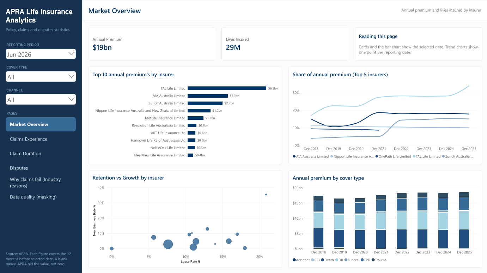

# Australian Life Insurance Claims & Disputes Analytics

A data validation, cleaning and reporting project built on APRA's public life insurance claims and disputes statistics (June 2018 to June 2026), covering **all authorised life insurers**. The data is validated and cleaned in Python, loaded into a PostgreSQL star schema, and reported in a Power BI dashboard.

> **Status: work in progress** (last updated 4 Nov 2026). The inspection, validation, cleaning, database and analysis view stages are done, and the Power BI dashboard is in progress.

## Project status

| Stage | Status | Files |
|---|---|---|
| Inspect raw data | Done | `src/inspect_data.py` |
| Validate raw data | Done | `src/validate_data.py`, `docs/data_validation.md` |
| Investigate data quirks | Done | `src/inspect_duration_conflicts.py`, `src/inspect_disputes_spelling.py`, `src/inspect_masking.py` |
| Clean to tidy CSVs | Done | `src/clean_data.py`, `docs/cleaning_log.txt` |
| Load to PostgreSQL | Done | `src/load_to_sql.py`, `sql/schema.sql`, `sql/load.sql` |
| Check the database against the reports | Done | `sql/checks.sql` |
| Build analysis views for Power BI | Done | `sql/views.sql` |
| Power BI dashboard | In progress | `powerbi/insurance_dashboard.pbix`, `powerbi/measures.dax` |

## The data

Source: APRA, *Life Insurance Claims and Disputes Statistics* (released half-yearly), with the explanatory notes and glossary. The workbook has four sheets used in this project:

| Sheet | Rows | What it holds |
|---|---|---|
| Policy Statistics | 23,797 | Lives insured, annual premium, market share, sum insured, new business and lapse rates |
| Claims | 95,261 | Claim counts by outcome (received, finalised, admitted, declined, withdrawn, undetermined), average sum insured, and claim duration |
| Disputes | 78,307 | Dispute counts and outcomes, average amount paid, and dispute duration |
| Other | 19,198 | **Industry-level only** (no company): claims frequency, claims paid ratio, and the reasons claims are declined or withdrawn and disputes are withdrawn or reversed |

Coverage: 17 reporting dates (30 June and 31 December each year), 20 ABNs (23 company names) plus an industry "Total", seven cover types (Death, TPD, Trauma, DII, CCI, Funeral, Accident) and four channels (Individual Advised, Individual Non-Advised, Group Super, Group Ordinary).

Every figure is a **rolling 12-month window** ending on the reporting date, so consecutive dates overlap by six months.

**Data version.** This repository includes the APRA release covering June 2018 to June 2026, and all numbers in this README describe that file (row counts, Excel row numbers, and the findings below). APRA can revise earlier figures in later releases, so a newer download may not match.

## Design principles

These follow from how the data is built, and they drive the cleaning rules.

- **Masked, missing and zero are three different things.** APRA masks a value with `*` when an insurer has fewer than 50 finalised claims. Masked values become NULL with a `value_status` flag, never zero.
- **Never sum across reporting dates.** The 12-month windows overlap. Use one date per year for annual totals, or treat each date as its own observation.
- **Never add a total to its parts.** The industry "Total" company, the "Total" channel and the "Total" reason category all contain the rows around them. They are flagged so charts can't double count.
- **Ratios can't be summed.** Aggregate the counts first, then recompute the ratio.
- **Flag, don't delete.** Rows that look wrong are kept with a flag (`is_invalid_combo`, `is_out_of_range`), and every dropped row is written to an exceptions file.

## Data quality findings

Found by `validate_data.py` and follow-up investigation. The latest validation run gave **65 passed, 4 warnings and 0 failures** (full results in `docs/data_validation.md`). The four warnings are the negative values in finding 8, the invalid combinations in finding 7 (one warning each for Claims and Disputes) and the capitalisation variants in finding 4 (Disputes). The duration conflict in finding 5 is reported as an explained, known quirk.

1. **Heavy masking.** About 42% of Claims values (40,075 rows) and 42% of Disputes values (32,696 rows) are masked. Claims masking ranges from 2% to about 78% depending on the insurer, so insurer-level claims metrics need to show how much of the data is hidden.
2. **"Total" is a company.** Each of the three company sheets has an industry "Total" company with a blank ABN (2,124 / 8,520 / 7,004 rows; the cell holds a single space, which cleaning converts to NULL). Where every value is visible, the sum of the insurers matches the Total for lives insured and annual premium (354 groups tested for each, no differences above 0.1%).
3. **Three ABNs changed name**: TAL Life Insurance Services (formerly Westpac Life Insurance Services), ART Life Insurance (formerly QInsure) and Nippon Life Insurance Australia and New Zealand (formerly MLC Limited). Companies are keyed on ABN, and name history is kept.
4. **Inconsistent capitalisation in Disputes**, for example "Disputes lodged" and "Disputes Lodged". Left uncorrected, this silently halved the number of groups a reconciliation could test, so names are normalised during cleaning.
5. **Contradictory duplicates.** Claims has 6 groups of exact duplicate rows (12 rows) and 10 groups (20 rows) where "Est. average duration" is published twice, once as 0 and once blank. Disputes has 3 groups of exact duplicates (6 rows). Inspecting each of the 10 groups showed that all have zero finalised claims, so the average is undefined. The validation step reports these as a known quirk, and the cleaning step keeps the blank, drops the 0, and logs the dropped rows. Any other conflicting duplicate stops the script. The cleaning run confirmed the drops: 6 exact duplicates and 10 zero-valued twins from Claims, and 3 exact duplicates from Disputes.
6. **Blank text in the Value column.** 10 Claims rows hold only spaces. They are treated as missing.
7. **Combinations APRA says can't exist.** APRA's notes list CCI × Group Super as not applicable, but the data has a block of rows for it under the industry Total only (24 rows in Claims, 20 in Disputes, 18 of each holding values). These are flagged and excluded from benchmarks.
8. **Negative lapse rates.** Three Policy Statistics values are negative (Excel rows 16099, 17731 and 23779), which the lapse rate definition (lapsed premium divided by average in-force premium) doesn't allow. They are flagged, not changed. Rates above 100% for lapse, new business and claims paid ratio are accepted as plausible.
9. **The Other sheet is a full grid**: 4,080 rows sit in invalid cover/channel combinations and all are blank.

Checks that passed:
- Claims and disputes reconciliations: received = finalised + withdrawn + undetermined, finalised = admitted + declined, lodged = resolved + withdrawn + undetermined, and resolved = maintained + reversed + other. Each was tested on 2,298 groups with no failures.
- On the Other sheet, reasons add up to the reported Total (2,704 groups, no failures).
- All reporting dates are valid 30 June / 31 December dates.
- No insurer name maps to more than one ABN.
- Every data item has exactly one unit and one calculation basis.
- The Notes column is only filled in on masked rows.
- No required column has a blank cell.

## Cleaning results

`clean_data.py` writes `policy_stats.csv`, `claims.csv`, `disputes.csv`, `industry_stats.csv` (the Other sheet), `company_names.csv` and `exceptions_dropped_duplicates.csv` to `data/processed/` (not committed), and logs the run to `docs/cleaning_log.txt`.

| Sheet | Rows read | Exact duplicates dropped | Zero-vs-blank twins dropped | Rows kept |
|---|---|---|---|---|
| Policy Statistics | 23,797 | 0 | 0 | 23,797 |
| Claims | 95,261 | 6 | 10 | 95,245 |
| Disputes | 78,307 | 3 | 0 | 78,304 |
| Other | 19,198 | 0 | 0 | 19,198 |

Value status after cleaning:

| Sheet | value | masked | missing |
|---|---|---|---|
| Policy Statistics | 23,795 | 2 | 0 |
| Claims | 53,783 | 40,075 | 1,387 |
| Disputes | 43,304 | 32,696 | 2,304 |
| Other | 13,758 | 1,024 | 4,416 |

Rows flagged and kept: 24 Claims and 20 Disputes rows with `is_invalid_combo` (the CCI × Group Super block from finding 7), 4,080 Other rows with `is_invalid_combo` (the blank grid from finding 9) and 3 Policy Statistics rows with `is_out_of_range` (the negative values from finding 8). `company_names.csv` holds 20 ABNs and 23 ABN/name pairs.

## Database

The cleaned CSVs are loaded into a PostgreSQL star schema. `sql/schema.sql` creates the tables, `src/load_to_sql.py` copies each CSV into a staging table, and `sql/load.sql` builds the dimensions and facts from staging. `sql/checks.sql` holds queries that re-derive numbers from the validation and cleaning reports (row counts, value status, flagged rows, industry Total against the sum of insurers, claims reconciliation, and masking by company). Its results match the validation and cleaning reports.

| Type | Tables |
|---|---|
| Dimensions | `dim_date`, `dim_company` (with `company_name_history`), `dim_channel`, `dim_cover`, `dim_category`, `dim_measure` |
| Facts | `fact_policy`, `fact_claims`, `fact_disputes`, `fact_industry` (the Other sheet, so no company) |

Load results (every CSV row became exactly one row in its table):

| Table | CSV rows | Rows loaded |
|---|---|---|
| fact_policy | 23,797 | 23,797 |
| fact_claims | 95,245 | 95,245 |
| fact_disputes | 78,304 | 78,304 |
| fact_industry | 19,198 | 19,198 |
| company_name_history | 23 | 23 |

The dimensions hold 17 dates, 21 companies (20 insurers plus the industry Total), 5 channels (the four channels plus Total), 7 covers, 28 categories (27 plus a "no category" row) and 35 measures.

`sql/views.sql` creates seven views that pivot the long fact tables into one row per date, company, channel and cover, which is the shape Power BI needs. They leave out the rows in invalid cover/channel combinations and the out-of-range values, and keep masked and missing values as NULL.

| View | What it holds |
|---|---|
| `v_policy` | lives insured, annual premium, sum insured, market share, new business and lapse rates |
| `v_claims` | claim outcomes, average sum insured and estimated average duration |
| `v_claims_duration` | one row per time band, with an estimated claim count |
| `v_disputes` | dispute outcomes, lodgement ratio, average amount paid and duration |
| `v_industry_reasons` | why claims are declined or withdrawn and disputes withdrawn or reversed (industry level) |
| `v_industry_ratios` | claims frequency and claims paid ratio (industry level) |
| `v_masking` | masked against total rows, for the data quality page |

Design decisions:

- **Companies are keyed on ABN**, with a name history table, so a renamed insurer stays one company. The industry Total has no ABN.
- **A measure is a subject plus a data item.** The same reason name appears under both claims withdrawn reasons and dispute withdrawn reasons, so a category alone is not unique. Each measure has one unit and one calculation basis.
- **Rows with no category point to a "(none)" category** (id 0), so no fact key contains a NULL.
- **Masked and missing values are NULL with a `value_status`**, and constraints stop a masked or missing row from holding a number.
- **`is_additive` marks which measures can be summed** (counts and dollar totals, but not rates, averages or shares). This is my own classification and not something APRA publishes.
- **The Total flags live on the dimensions** (`is_industry_total`, `is_total_channel`, `is_total_category`), so one filter excludes them everywhere.
- **The load is one transaction.** It compares each table's row count with its CSV and rolls everything back if any count differs, so a failed load leaves the database as it was.

## Dashboard

The Power BI report (`powerbi/insurance_dashboard.pbix`) imports the four dimension tables and the seven views: 11 tables, 26 relationships and 33 DAX measures (`powerbi/measures.dax`).

| Page | Question it answers | Status |
|---|---|---|
| Market overview | Who writes the premium, and how are share, lapse and new business rates moving? | Built |
| Claims experience | How often are claims admitted, by cover and insurer, compared with the industry? | In progress |
| Claim duration | How long do insurers take to finalise claims? | In progress |
| Disputes | How many disputes are lodged, and how often are decisions reversed? | In progress |
| Why claims fail | Why are claims declined or withdrawn, and disputes withdrawn or reversed? | In progress |
| Data quality | How much of the data does APRA hide, by insurer? | In progress |

How the measures follow the design principles:

- **Additive measures are blank unless exactly one reporting date is selected**, so overlapping 12-month windows are never added together.
- **Base measures exclude the industry Total company.** Separate "industry" measures use APRA's own Total rows as the benchmark, because the Total is usually shown even when individual insurers are masked.
- **Rates use only rows where the numerator and denominator are both visible**, so a hidden value never skews a rate.
- **Lives insured is counted once per cover**, so a total across covers is not a count of distinct people.



## Key results (Jun 2026)

Industry claims and insurer dispute outcomes at the latest reporting date, from `v_claims` and `v_disputes`.

**Claim admit rate by cover** (admitted claims divided by finalised claims, using APRA's industry totals where the figures are shown in full):

| Cover | Finalised claims | Admit rate |
|---|---|---|
| Accident | 2,083 | 86.1% |
| Trauma | 5,269 | 87.3% |
| TPD | 23,949 | 87.8% |
| CCI | 914 | 92.0% |
| DII | 34,501 | 95.4% |
| Death | 16,456 | 97.6% |
| Funeral | 15,244 | 99.8% |

The admit rate leaves out withdrawn and undetermined claims. APRA also counts cases where the insurer paid something other than the full benefit (for example a partial settlement or premium refund) as declined.

**Dispute reversal rate by cover** (reversed disputes divided by resolved disputes, for insurers whose dispute data APRA shows in full):

| Cover | Resolved disputes | Reversed disputes | Reversal rate |
|---|---|---|---|
| Trauma | 375 | 14 | 3.7% |
| Death | 416 | 13 | 3.1% |
| DII | 6,172 | 157 | 2.5% |
| TPD | 4,003 | 84 | 2.1% |
| Accident | 62 | 1 | 1.6% |
| Funeral | 234 | 0 | 0.0% |
| CCI | 107 | 0 | 0.0% |

"Other dispute outcomes" is a separate category from "reversed", so the reversal rate is not the share of disputes that ended in the claimant's favour. Counts for Accident, CCI and Funeral are small, so those rates move a lot with a few disputes.

## Repository structure

```
APRA-Insurance-Analysis/
├── data/
│   ├── raw/             # APRA raw insurance data, release to June 2026
│   └── processed/       # tidy CSVs from clean_data.py (not committed)
├── src/
│   ├── inspect_data.py               # sheet names, shapes, previews, masked counts
│   ├── validate_data.py              # integrity checks -> docs/data_validation.md
│   ├── inspect_duration_conflicts.py # one-off investigation behind finding 5
│   ├── inspect_disputes_spelling.py  # one-off check behind finding 4
│   ├── inspect_masking.py            # masked share of values per insurer, from the raw sheets
│   ├── clean_data.py                 # tidy, typed, flagged CSVs
│   └── load_to_sql.py                # loads the CSVs into PostgreSQL and checks row counts
├── sql/
│   ├── schema.sql                    # star schema and staging tables
│   ├── load.sql                      # builds dimensions and facts from staging
│   ├── views.sql                     # analysis views for Power BI
│   └── checks.sql                    # queries that re-derive numbers from the reports
├── powerbi/
│   ├── insurance_dashboard.pbix      # the dashboard (holds an imported copy of the data)
│   └── measures.dax                  # all 33 DAX measures
├── docs/
│   ├── data_validation.md
│   ├── cleaning_log.txt
│   └── conflicting_duplicates_claims.csv
├── .env                 # database connection details (not committed)
├── .gitignore
├── requirements.txt
└── README.md
```

## How to run

1. Install dependencies: `pip install -r requirements.txt`
2. Create a PostgreSQL database (for example `CREATE DATABASE insurance_analytics;`) and add a `.env` file in the project root:

```
PGHOST=localhost
PGPORT=5432
PGDATABASE=insurance_analytics
PGUSER=postgres
PGPASSWORD=your_password
```

3. Run each stage from the project root:

```
python src/inspect_data.py
python src/validate_data.py     # writes docs/data_validation.md
python src/clean_data.py        # writes data/processed/*.csv and docs/cleaning_log.txt
python src/load_to_sql.py       # builds the tables and views in PostgreSQL and checks the row counts
```

Then run `sql/checks.sql` in pgAdmin or psql to compare the database with the validation and cleaning reports.

To open the dashboard, use Power BI Desktop (Windows) to open `powerbi/insurance_dashboard.pbix`. It holds an imported copy of the data, so it opens without the database. To refresh it, point its data source at your own PostgreSQL database (Home, then Transform data, then Data source settings).

## Limitations

- Masking hides most small-insurer claims and disputes data, so insurer-level comparisons are only possible where values are visible.
- The Other sheet has no company dimension, so reasons and ratios are market-wide only.
- Insurers that left or were renamed are separate entries in time, so market trends partly reflect entries and exits.
- The glossary lists seven duration buckets, but the file has five for claims and three for disputes, so average duration is taken as reported and not recomputed.
- Lives insured is counted per cover, so adding it across covers counts a person once for each cover they hold.
- The dashboard file is a snapshot of the data at the time it was saved and does not update itself when the database changes.
- Findings apply to this release only and haven’t been re-checked against later releases.

## Tech

Python (pandas, numpy, psycopg2), PostgreSQL and Power BI (DAX).

## Data source and disclaimer

Data: Australian Prudential Regulation Authority (APRA), [*Life Insurance Claims and Disputes Statistics*](https://www.apra.gov.au/news-and-publications/life-insurance-claims-and-disputes-statistics). This project is independent and not affiliated with or endorsed by APRA.